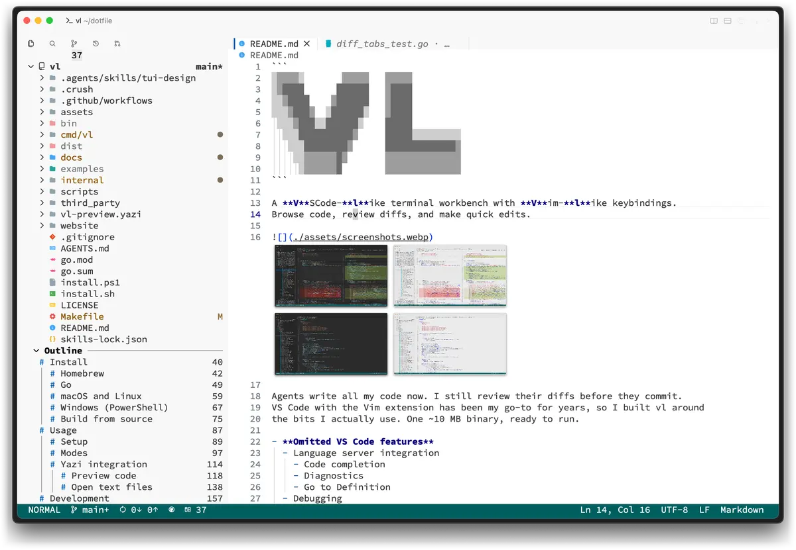
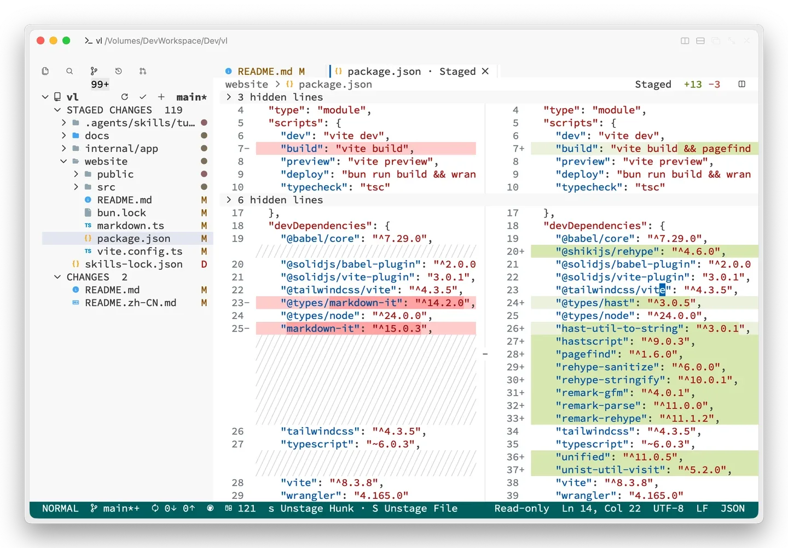
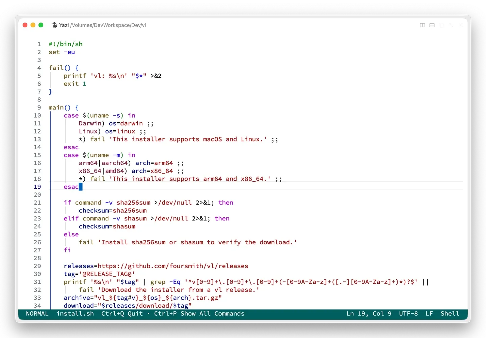

```
░▒▒▒▒░       ▒▒▒▒▒   ▒▒▒▒▒
░▒▓▓▓▓      ▓▓▓▓▓▓   ▒▓▓▓▓
░░▒▓▓▓▓    ▒▓▓▓▓▓▓   ▒▓▓▓▓
░░░▒▓▓▓▒  ░▓▓▓▓▓▓░   ▒▓▓▓▓
 ░░░▒▓▓▓░░▓▓▓▓▓▓░    ▓▓▓▓▓
  ░░░▓▓▓▓▓▓▓▓▓▓▒     ▓▓▓▓▓░░░░░░░░░
   ░░░▓▓▓▓▓▓▓▓▒      ▓▓▓▓▓▓▓▓▓▓▓▓▓▒
    ░░▒▒▒▒▒▒▓▒       ▒▒▒▒▒▒▒▒▒▒▒▒▒▒
     ░▒▒▒▒▒▒▓        ▒▒▒▒▒▒▒▒▒▒▒▒▒▒
```

<p align="center">
  English · <a href="README.zh-CN.md">简体中文</a>
</p>

**Read code, review Git diffs, and make quick edits right in your terminal, just like in VS Code.**

<picture>
  <source media="(prefers-color-scheme: dark)" srcset="./website/src/assets/browse-dark.webp">
  <source media="(prefers-color-scheme: light)" srcset="./website/src/assets/browse-light.webp">
  
</picture>

<picture>
  <source media="(prefers-color-scheme: dark)" srcset="./website/src/assets/diff-dark.webp">
  <source media="(prefers-color-scheme: light)" srcset="./website/src/assets/diff-light.webp">
  
</picture>

<picture>
  <source media="(prefers-color-scheme: dark)" srcset="./website/src/assets/edit-dark.webp">
  <source media="(prefers-color-scheme: light)" srcset="./website/src/assets/edit-light.webp">
  
</picture>

## Install

```sh
brew install foursmith/tap/vl
```

See the [installation guide](https://vl.foursmith.com/docs/install) for Go, Windows, install scripts, building from source, and optional Homebrew dependencies.

## Quickstart

Run `vl .` in your project directory to open the workbench.

Select a Nerd Font in your terminal to display file icons, or run `vl --icons=false .` to use plain-text icons.

Text files open in **Vim Normal mode** by default. Press `i` to type and `Esc` to return to Normal mode. To turn off Vim keybindings, press `Ctrl+P` and run **Preferences: Toggle Vim Mode**.

- `Ctrl+G` finds a file by name or path.
- `Ctrl+Shift+F` searches file contents across the workspace.
- `Ctrl+3` opens the Changes view in a Git repository.

## Documentation

- [Quickstart](https://vl.foursmith.com/docs/) for browsing code and reviewing Git changes.
- [Command line](https://vl.foursmith.com/docs/cli) for startup options, file positions, and `vl preview`.
- [Keyboard shortcuts](https://vl.foursmith.com/docs/shortcuts) for default bindings and customization.
- [Configuration](https://vl.foursmith.com/docs/configuration) for themes, input methods, and integrations.

## Development

```sh
make build  # updates bin/vl
make test
make check  # go vet + race-enabled tests
```

## Acknowledgments

- [TTT](https://github.com/eugenioenko/ttt) and [textmate-go](https://github.com/eugenioenko/textmate-go) for syntax highlighting and implementation inspiration.
- [VS Code](https://github.com/microsoft/vscode) for the workbench design and [Vim](https://github.com/vim/vim) for the keybindings.

## License

This Source Code Form is subject to the terms of the Mozilla Public License,
v. 2.0. If a copy of the MPL was not distributed with this file, You can obtain
one at https://mozilla.org/MPL/2.0/.

See [LICENSE](LICENSE) for the full text. Third-party components retain their
respective licenses; see [Third-party notices](THIRD_PARTY_NOTICES.md).
