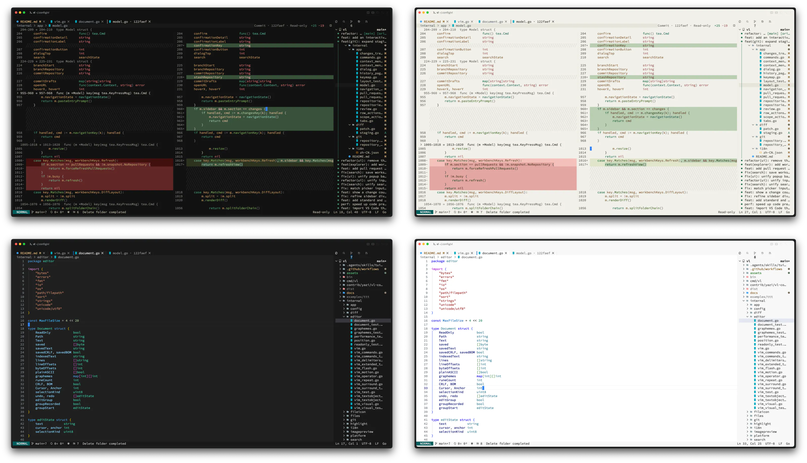

```
░▒▒▒▒░       ▒▒▒▒▒   ▒▒▒▒▒
░▒▓▓▓▓      ▓▓▓▓▓▓   ▒▓▓▓▓
░░▒▓▓▓▓    ▒▓▓▓▓▓▓   ▒▓▓▓▓
░░░▒▓▓▓▒  ░▓▓▓▓▓▓░   ▒▓▓▓▓
 ░░░▒▓▓▓░░▓▓▓▓▓▓░    ▓▓▓▓▓
  ░░░▓▓▓▓▓▓▓▓▓▓▒     ▓▓▓▓▓░░░░░░░░░
   ░░░▓▓▓▓▓▓▓▓▒      ▓▓▓▓▓▓▓▓▓▓▓▓▓▒
    ░░▒▒▒▒▒▒▓▒       ▒▒▒▒▒▒▒▒▒▒▒▒▒▒
     ░▒▒▒▒▒▒▓        ▒▒▒▒▒▒▒▒▒▒▒▒▒▒
```

A **V**SCode-**l**ike terminal workbench with **V**im-**l**ike keybindings.
Browse code, review diffs, and make quick edits.



Agents write all my code now. I still review their diffs before they commit.
VS Code with the Vim extension has been my go-to for years, so I built vl around
the bits I actually use. One ~10 MB binary, ready to run.

## Install

### Go

Requires Go 1.27.3 or newer.

```sh
go install github.com/foursmith/vl/cmd/vl@latest
```

Add Go's bin directory to your `PATH` if needed.

### macOS and Linux

```sh
curl -fsSL https://github.com/foursmith/vl/releases/latest/download/install.sh | sh
```

Installs to `~/.local/bin`. Add that directory to your `PATH` if needed.

### Windows (PowerShell)

```powershell
Invoke-RestMethod -UseBasicParsing https://github.com/foursmith/vl/releases/latest/download/install.ps1 | Invoke-Expression
```

Installs to `%LOCALAPPDATA%\vl\bin` and adds it to your user `PATH`.

### Build from source

Build from source with Go 1.27.3 or newer.

```sh
git clone https://github.com/foursmith/vl.git
cd vl
make build
```

Run `./bin/vl` from the checkout or copy it into a directory on your `PATH`.

### Homebrew

Homebrew support is pending.

<details>
<summary>Homebrew install commands</summary>

```sh
brew tap foursmith/tap
brew trust --formula foursmith/tap/vl
brew install vl
```

</details>

## Usage

### Setup

- Workbench mode requires Git on your `PATH`. [Git](https://git-scm.com/)
- For GitHub pull requests, install `gh` and run `gh auth login`. [GitHub CLI](https://cli.github.com/)
- For SVG previews, install `resvg` and put it on your `PATH`. [resvg](https://github.com/linebender/resvg)
- For file icons, install a Nerd Font and select it in your terminal's font settings. [Nerd Fonts](https://github.com/ryanoasis/nerd-fonts)

### Modes

- **Workbench mode.** Run `vl .` to browse files, search the workspace, and review Git changes.
- **Preview mode.** Run `vl preview path/to/file` to print syntax-highlighted code in your terminal.
- **Editor mode.** Run `vl path/to/file` to open a single file in the Vim-like editor.

See [Keyboard shortcuts](docs/KEYBINDINGS.md) for the workbench and
[Where vl differs from Vim](docs/VIM.md#where-vl-differs-from-vim) for editor keys.

### Yazi integration

Make sure `vl` is on your `PATH`.

#### Preview code

Requires Yazi 26.9.1 or newer. Install the preview plugin.

```sh
ya pkg add foursmith/vl:vl-preview
```

Enable code previews in `yazi.toml`.

```toml
[[plugin.prepend_previewers]]
mime = "text/*"
run = "vl-preview"

[[plugin.prepend_previewers]]
mime = "application/{mbox,javascript,wine-extension-ini}"
run = "vl-preview"
```

#### Open text files

Add this to `yazi.toml` to open text files in vl with Enter or `o`.

```toml
[[opener.vl]]
run = "vl -- %s1"
block = true
desc = "Edit in vl"

[[open.prepend_rules]]
mime = "text/*"
use = ["vl", "reveal"]

[[open.prepend_rules]]
mime = "application/{json,ndjson,mbox,javascript,wine-extension-ini}"
use = ["vl", "reveal"]
```

## Development

```sh
make build  # updates bin/vl
make test
make check  # go vet + race-enabled tests
```
## License

This Source Code Form is subject to the terms of the Mozilla Public License,
v. 2.0. If a copy of the MPL was not distributed with this file, You can obtain
one at https://mozilla.org/MPL/2.0/.

See [LICENSE](LICENSE) for the full text. Third-party components retain their
respective licenses; see [Third-party notices](THIRD_PARTY_NOTICES.md).
