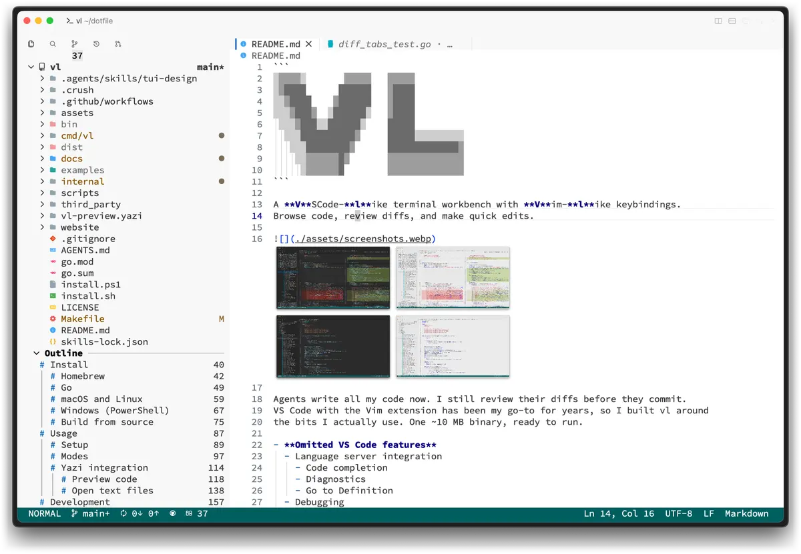
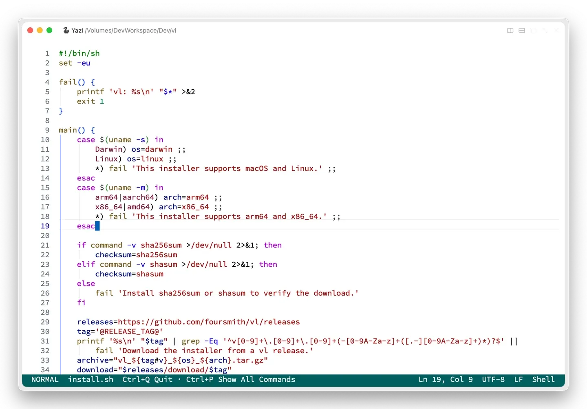

```
░▒▒▒▒░       ▒▒▒▒▒   ▒▒▒▒▒
░▒▓▓▓▓      ▓▓▓▓▓▓   ▒▓▓▓▓
░░▒▓▓▓▓    ▒▓▓▓▓▓▓   ▒▓▓▓▓
░░░▒▓▓▓▒  ░▓▓▓▓▓▓░   ▒▓▓▓▓
 ░░░▒▓▓▓░░▓▓▓▓▓▓░    ▓▓▓▓▓
  ░░░▓▓▓▓▓▓▓▓▓▓▒     ▓▓▓▓▓░░░░░░░░░
   ░░░▓▓▓▓▓▓▓▓▒      ▓▓▓▓▓▓▓▓▓▓▓▓▓▒
    ░░▒▒▒▒▒▒▓▒       ▒▒▒▒▒▒▒▒▒▒▒▒▒▒
     ░▒▒▒▒▒▒▓        ▒▒▒▒▒▒▒▒▒▒▒▒▒▒
```

<p align="center">
  <a href="README.md">English</a> · 简体中文
</p>

**在终端里像用 VS Code 一样读代码、审阅 Git 改动，顺手改几行。**

<picture>
  <source media="(prefers-color-scheme: dark)" srcset="./website/src/assets/browse-dark.webp">
  <source media="(prefers-color-scheme: light)" srcset="./website/src/assets/browse-light.webp">
  
</picture>

<picture>
  <source media="(prefers-color-scheme: dark)" srcset="./website/src/assets/diff-dark.webp">
  <source media="(prefers-color-scheme: light)" srcset="./website/src/assets/diff-light.webp">
  
</picture>

<picture>
  <source media="(prefers-color-scheme: dark)" srcset="./website/src/assets/edit-dark.webp">
  <source media="(prefers-color-scheme: light)" srcset="./website/src/assets/edit-light.webp">
  
</picture>

## 安装

```sh
brew install foursmith/tap/vl
```

Go、Windows、安装脚本、源码构建和 Homebrew 可选依赖的用法见[安装文档](https://vl.foursmith.com/zh-CN/docs/install)。

## 快速上手

在项目目录下运行 `vl .`，打开工作台。

在终端字体设置中选用 Nerd Font 来显示文件图标，也可以运行 `vl --icons=false .` 使用纯文本图标。

文本文件默认以 **Vim 普通模式（Normal）** 打开。按 `i` 开始输入，按 `Esc` 返回普通模式。想关闭 Vim 键位，按 `Ctrl+P` 打开命令面板，选择「切换 Vim 模式」（**Toggle Vim Mode**）。

- `Ctrl+G` 按文件名或路径找文件。
- `Ctrl+Shift+F` 搜索工作区里的文件内容。
- `Ctrl+3` 在 Git 仓库中打开「更改」视图。

## 文档

- [快速上手](https://vl.foursmith.com/zh-CN/docs/)涵盖浏览代码和审阅 Git 改动。
- [命令行](https://vl.foursmith.com/zh-CN/docs/cli)涵盖启动参数、文件定位和 `vl preview`。
- [键盘快捷键](https://vl.foursmith.com/zh-CN/docs/shortcuts)列出默认键位和自定义方法。
- [VL 配置](https://vl.foursmith.com/zh-CN/docs/configuration)涵盖主题、输入法和集成。

## 开发

```sh
make build  # 更新 bin/vl
make test
make check  # 运行 go vet 和启用竞态检测的测试
```

## 致谢

- 感谢 [TTT](https://github.com/eugenioenko/ttt) 和 [textmate-go](https://github.com/eugenioenko/textmate-go) 提供语法高亮支持和实现参考。
- 工作台设计参考 [VS Code](https://github.com/microsoft/vscode)，键位参考 [Vim](https://github.com/vim/vim)。

## 许可证

本源代码受 Mozilla Public License 2.0（MPL 2.0）条款约束。如果随附文件中没有 MPL 副本，可以前往 [MPL 2.0 官网](https://mozilla.org/MPL/2.0/)获取。

完整条款见 [LICENSE](LICENSE)。第三方组件沿用各自的许可证，详见[第三方声明](THIRD_PARTY_NOTICES.md)。
