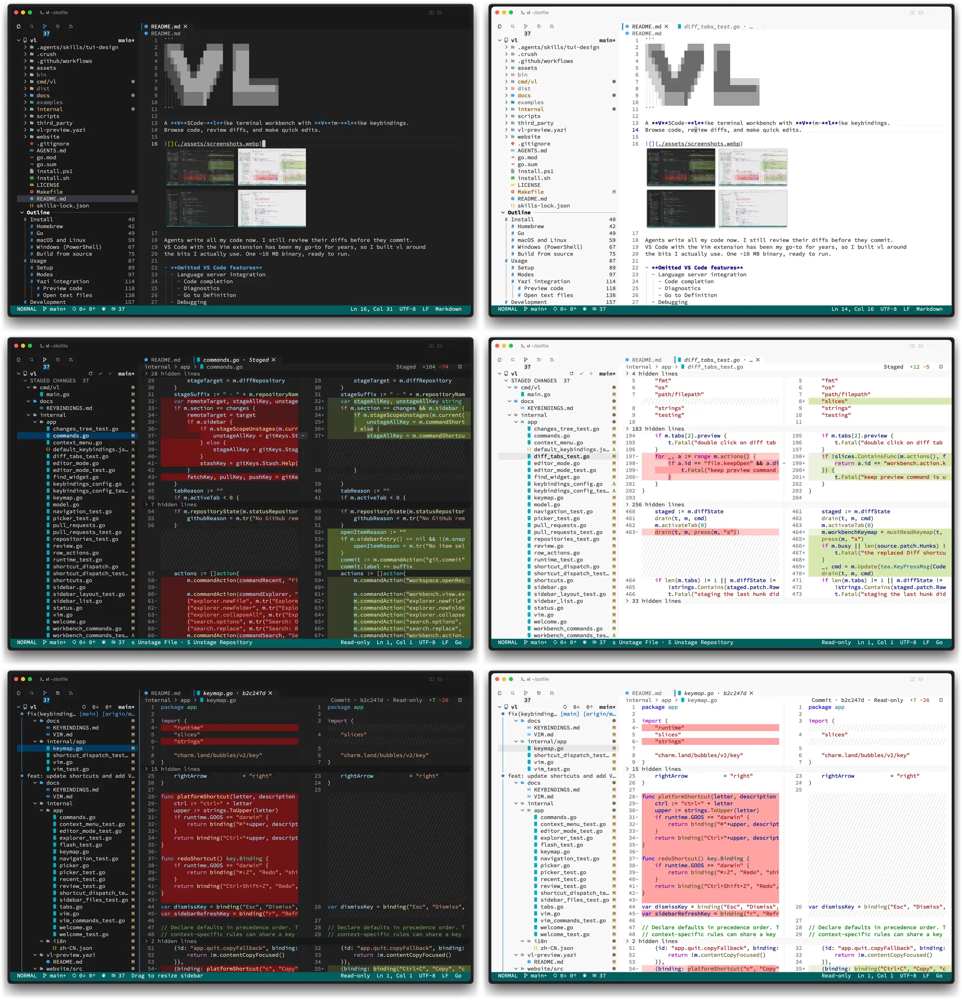

```
░▒▒▒▒░       ▒▒▒▒▒   ▒▒▒▒▒
░▒▓▓▓▓      ▓▓▓▓▓▓   ▒▓▓▓▓
░░▒▓▓▓▓    ▒▓▓▓▓▓▓   ▒▓▓▓▓
░░░▒▓▓▓▒  ░▓▓▓▓▓▓░   ▒▓▓▓▓
 ░░░▒▓▓▓░░▓▓▓▓▓▓░    ▓▓▓▓▓
  ░░░▓▓▓▓▓▓▓▓▓▓▒     ▓▓▓▓▓░░░░░░░░░
   ░░░▓▓▓▓▓▓▓▓▒      ▓▓▓▓▓▓▓▓▓▓▓▓▓▒
    ░░▒▒▒▒▒▒▓▒       ▒▒▒▒▒▒▒▒▒▒▒▒▒▒
     ░▒▒▒▒▒▒▓        ▒▒▒▒▒▒▒▒▒▒▒▒▒▒
```

<p align="center">
  <a href="README.md">English</a> · 简体中文
</p>

VS Code 风格的终端工作台，支持 Vim 键位。
浏览代码、审查 diff，顺手改几行。



现在我的代码都交给 Agent 写，提交前我还是会过一遍 diff。
VS Code 加 Vim 扩展是我用了好几年的组合。做 vl 时，我挑的都是自己平时用得上的功能。
整个工具就一个约 10 MB 的二进制文件，拿来就能跑。

- **省掉的 VS Code 功能**
  - 语言服务器集成
    - 代码补全
    - 诊断
    - 跳转到定义
  - 调试
  - 集成终端
  - 构建和测试任务
  - 扩展运行环境和扩展市场
- **省掉的 Vim 功能**
  - 可视块模式
  - 宏
  - 命名寄存器
  - 标记与标记跳转
  - Ex 命令
  - Vimscript 配置和插件

## 安装

### Homebrew

```sh
brew tap foursmith/tap
brew install foursmith/tap/vl
```

### Go

需要 Go 1.27.3 或更高版本。

```sh
go install github.com/foursmith/vl/cmd/vl@latest
```

如果 Go 的可执行文件目录还没加到 `PATH`，记得加上。

### macOS 和 Linux

```sh
curl -fsSL https://github.com/foursmith/vl/releases/latest/download/install.sh | sh
```

会安装到 `~/.local/bin`。如果这个目录还没加到 `PATH`，记得加上。

### Windows (PowerShell)

```powershell
Invoke-RestMethod -UseBasicParsing https://github.com/foursmith/vl/releases/latest/download/install.ps1 | Invoke-Expression
```

会安装到 `%LOCALAPPDATA%\vl\bin`，并将该目录加到用户的 `PATH`。

### 从源码构建

需要 Go 1.27.3 或更高版本。

```sh
git clone https://github.com/foursmith/vl.git
cd vl
make build
```

可以在仓库目录下直接运行 `./bin/vl`，也可以把它复制到 `PATH` 里的任意目录。

## 用法

### 环境准备

- 工作台模式需要 Git，请确保能从 `PATH` 找到 `git`。[Git](https://git-scm.com/)
- 要使用 GitHub 的 Pull Request 功能，请安装 `gh` 并运行 `gh auth login`。[GitHub CLI](https://cli.github.com/)
- 要显示 Markdown 里的远程图片，请安装 `curl`。
- 要预览 SVG，请安装 `resvg` 并将它所在的目录加到 `PATH`。[resvg](https://github.com/linebender/resvg)
- 要显示文件图标，请安装 Nerd Font，并在终端的字体设置里选用它。[Nerd Fonts](https://github.com/ryanoasis/nerd-fonts)

### 运行模式

- **工作台模式**。运行 `vl .`，浏览文件、搜索工作区、查看 Git 变更。
- **编辑器模式**。运行 `vl path/to/file`，用支持 Vim 风格按键的编辑器打开单个文件。
- **预览模式**。运行 `vl preview path/to/file`，在终端输出带语法高亮的代码。

点击右下角状态栏里的语言，或者在命令面板中选择**更改语法高亮**，就能为当前文件指定高亮语言。
设置按文件保存，对 `vl preview` 也生效。选择**自动检测**时，vl 会根据文件名或可识别的 shebang 判断语言，例如
`#!/bin/sh`、`#!/usr/bin/env node` 和 `#!/usr/bin/env python3`。选择**纯文本**即可关闭当前文件的语法高亮。

工作台的操作见[键盘快捷键](docs/KEYBINDINGS.zh-CN.md)，编辑器的按键差异见 [vl 与 Vim 的区别](docs/VIM.zh-CN.md#vl-与-vim-的区别)。

### Yazi 集成

请确保能从 `PATH` 找到 `vl`。

#### 预览代码

需要 Yazi 26.9.1 或更高版本。先安装预览插件。

```sh
ya pkg add foursmith/vl:vl-preview
```

在 `yazi.toml` 中添加以下配置，启用代码预览。

```toml
[[plugin.prepend_previewers]]
mime = "text/*"
run = "vl-preview"

[[plugin.prepend_previewers]]
mime = "application/{mbox,javascript,wine-extension-ini}"
run = "vl-preview"
```

#### 打开文本文件

在 `yazi.toml` 中添加以下配置，就能按 Enter 或 `o` 用 vl 打开文本文件。

```toml
[[opener.vl]]
run = "vl -- %s1"
block = true
desc = "Edit in vl"

[[open.prepend_rules]]
mime = "text/*"
use = ["vl", "reveal"]

[[open.prepend_rules]]
mime = "application/{json,ndjson,mbox,javascript,wine-extension-ini}"
use = ["vl", "reveal"]
```

## 开发

```sh
make build  # 更新 bin/vl
make test
make check  # 运行 go vet 和启用竞态检测的测试
```

## 致谢

- 感谢 [TTT](https://github.com/eugenioenko/ttt) 提供 [textmate-go](https://github.com/eugenioenko/textmate-go)，也为 vl 的实现提供了参考。
- 感谢 [VS Code](https://github.com/microsoft/vscode)，vl 的整套界面都参考了它。
- 感谢 [Vim](https://github.com/vim/vim)，vl 的按键设计参考了它。

## 许可证

本源代码受 Mozilla Public License 2.0（MPL 2.0）条款约束。如果随附文件中没有 MPL 副本，可以前往 [MPL 2.0 官网](https://mozilla.org/MPL/2.0/)获取。

完整条款见 [LICENSE](LICENSE)。第三方组件沿用各自的许可证，详见[第三方声明](THIRD_PARTY_NOTICES.md)。
